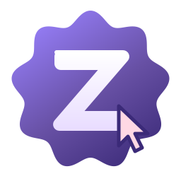

<p align="center"></p>

<h1 align="center">Z Admin</h1>

<p align="center">Удалённый доступ к компьютеру с разрешения пользователя. Windows 10 и 11 (64-бит).</p>

## Скачать

**[ZAdmin-Portable.exe (последняя версия)](https://github.com/Nenormalniypon/zadmin/releases/latest/download/ZAdmin-Portable.exe)**

Все версии и список изменений: [Releases](https://github.com/Nenormalniypon/zadmin/releases).

## Как запустить

1. Скачайте exe и запустите. Установка не нужна, при первом запуске программа распаковывается пару секунд.
2. Если Windows пишет «Система Windows защитила ваш компьютер», нажмите «Подробнее», затем «Выполнить в любом случае». Файл проверен Microsoft Defender, предупреждение появляется потому, что программа новая и без цифровой подписи.
3. У обоих компьютеров должна быть одна и та же версия.

## Как подключиться

- **Кому помогают:** нажимает «Запустить» и отправляет ссылку и пароль.
- **Кто помогает:** вставляет ссылку и пароль и нажимает «Подключиться».
- Пользователь сам выбирает, что разрешить: экран, управление, файлы, буфер обмена, голос. Сеанс можно закончить в любой момент кнопкой на баннере или сочетанием Ctrl+Alt+Shift+X.

## Проверка файла

SHA-256 каждой сборки указан в описании релиза. Проверить скачанный файл можно в PowerShell:

```
Get-FileHash .\ZAdmin-Portable.exe -Algorithm SHA256
```

## Лицензия

© 2026 zkito. Все права защищены. Пользоваться официальной сборкой можно, копировать, изменять и использовать в своих проектах нельзя. Подробно в файле [LICENSE](LICENSE). Сторонние компоненты: [THIRD-PARTY-NOTICES.txt](THIRD-PARTY-NOTICES.txt).
